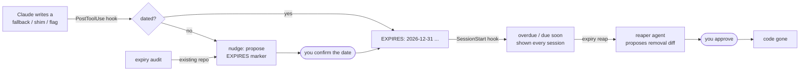
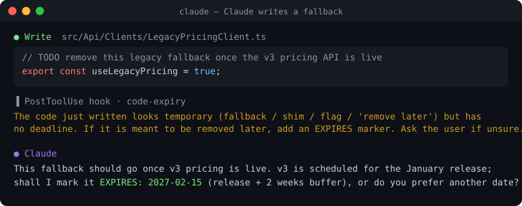
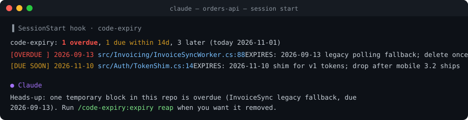
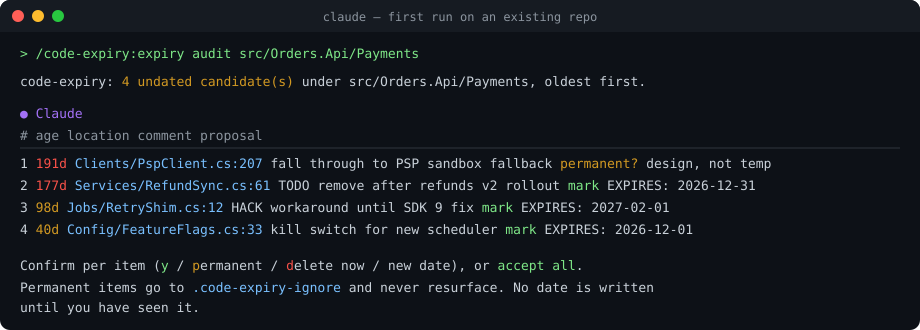

# code-expiry

> Temporary code with an expiry date. A Claude Code plugin that dates fallbacks, flags and shims when they are written, surfaces them when they are due, and removes them on command.

AI agents write temporary code fast. A fallback to the legacy path, a shim until the new API ships, a kill switch for the rollout, "TODO remove after migration". Nobody tracks it, so it becomes permanent. `code-expiry` closes that loop from inside the agent that wrote the code.

```
/plugin install code-expiry --marketplace andremoah/claude-plugins
```

## How it works



Four moments, one marker.

### 1. The marker

One comment line directly above the temporary block. Any language, any comment syntax.

```csharp
// EXPIRES: 2026-09-13 legacy polling fallback; delete once webhook delivery stays at 100% for 30d
if (invoice.WebhookId is null) { ... }
```

The date is ISO. The rest says why it is temporary and what must be true to delete it. Also accepted: `EXPIRES(2026-09-13)`, `@expires(2026-09-13)`, and `TODO [2026-09-13]` (eslint-plugin-unicorn style).

Plain `TODO` comments without a date are **never** treated as expiring.

### 2. Claude dates temp code as it writes it

A `PostToolUse` hook watches every Edit and Write. When the new code smells temporary (fallback, shim, legacy, workaround, feature flag, "TODO remove…") and carries no date, Claude is nudged to propose a marker. You decide the date. Nothing is written that you have not seen.



### 3. Due items show up at session start

A `SessionStart` hook scans the repo and injects overdue and due-within-14-days items into context. Claude mentions them once. Silent when there is nothing due.



### 4. Removal is a command, with a human in the loop

`/code-expiry:expiry reap` hands an expired item to the `reaper` agent. It reads the guarded block, greps for references, flags removal conditions it cannot verify from code (runtime metrics, rollout state), and proposes a minimal diff. It never applies anything on its own.


## First run on an existing repo

`/code-expiry:expiry audit [path]` finds comments that smell temporary but carry no date, shows each with its age from `git blame`, oldest first, and triages them with you in batches of ten.



Per item you choose **mark** (Claude proposes a date and reason, you confirm or change it), **permanent** (written to `.code-expiry-ignore` so it never resurfaces), or **delete now** (handed to the reaper). Scope with a path on big repos. `--all-todos` widens it to every plain TODO.

## Commands

```
/code-expiry:expiry                          overdue + due within 14 days
/code-expiry:expiry all                      everything, including later dates
/code-expiry:expiry audit [path]             onboarding: find undated temp code, triage, add markers
/code-expiry:expiry extend <file:line> <date>
/code-expiry:expiry reap                     reaper over every overdue item, one at a time
/code-expiry:expiry reap <file:line>         reaper on one item
```

## CI

The scanner is a dependency-free bash script. Fail the build when something is overdue:

```yaml
- name: code-expiry
  run: bash scripts/scan.sh --root . --fail-on-overdue
```

`--json` gives machine-readable output for dashboards.

## What is inside

| Part | File | Role |
|---|---|---|
| Scanner | `scripts/scan.sh` | Finds markers, classifies overdue / soon / later; `--candidates` mode for audit |
| SessionStart hook | `scripts/session-start.sh` | Injects due items into context |
| PostToolUse hook | `scripts/nudge.sh` | Nudges on undated temp code |
| Command | `commands/expiry.md` | `/code-expiry:expiry …` |
| Agent | `agents/reaper.md` | Safe removal, propose-only |
| Skill | `skills/code-expiry/SKILL.md` | Teaches Claude the convention and what counts as temporary |

Requirements: bash, grep, sed, date (BSD or GNU), git for ages and `.gitignore` awareness. No npm, no Python.

## Why not a linter rule?

Per-language expiring-TODO linters exist ([eslint-plugin-unicorn](https://github.com/sindresorhus/eslint-plugin-unicorn/blob/main/docs/rules/expiring-todo-comments.md), [todo_or_die](https://github.com/searls/todo_or_die), [flutter_style_expiring_todos](https://pub.dev/packages/flutter_style_expiring_todos)). They fail the build when a date passes. They cannot date the code at the moment it is written, cannot triage a legacy repo with you, and cannot remove the code. This plugin does all three, in any language, where the code is being written.

## Development

```
claude plugin marketplace add /path/to/claude-plugins
claude plugin install code-expiry
claude plugin validate /path/to/claude-plugins/code-expiry
```

Edits are picked up with `/reload-plugins`. The terminal images in `docs/` are SVG mockups rendered from real session output.

## License

MIT
