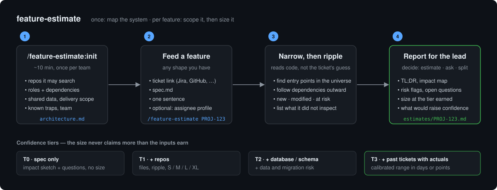

# feature-estimate

Scope a feature before anyone commits to a date.

Estimation eats tech-lead time and still misses, mostly because the hard part is not the number
but knowing what the change actually touches. This plugin does that part first: it builds a map of
your repositories once, then for each feature returns **what it touches, what could break, what is
still unclear**, and only then a size, at the confidence your inputs justify.

## How it works



**Once:** `/feature-estimate:init` walks you through ~10 minutes of questions, detecting what it can
from your repos and asking the rest, and writes two files at your workspace root:

- `architecture.md` — repos, roles, dependencies, shared data, delivery scope, team, known traps. Human-readable; edit it any time.
- `estimate.config.yml` — the machine-readable part (paths, unit, multipliers, references file).

**Per feature:** `/feature-estimate <ticket | path.md | "text">` reads those files, narrows the repo
universe to what the spec touches, follows dependencies outward, and reports:

1. Impact map — files new / modified / at risk, per repo; data and external systems
2. Risk flags — framework ripple, contract changes, migrations, untested areas, your team's known traps
3. Open questions — every assumption it had to make
4. Size — at the highest tier the inputs allow

The result is written to `estimates/<ticket>.md` for the tech lead; chat shows only the TL;DR. The TL;DR is built to support one decision: **estimate now, ask first, or split**.

| Tier | Inputs | Size output |
|---|---|---|
| T0 | spec only | none; questions |
| T1 | + repos | S / M / L / XL |
| T2 | + DB / schema | S–XL with data risk |
| T3 | + ≥5 past tickets with actuals | calibrated range in your unit, references shown |

No days or points below T3. The size assumes a developer who knows the codebase; pass
`--assignee junior/new` (experience / familiarity) for an adjusted figure on top.

## Install

```
/plugin install feature-estimate --marketplace andremoah/claude-plugins
/feature-estimate:init
```

## Commands

```
/feature-estimate:init                 guided setup, writes architecture.md + estimate.config.yml
/feature-estimate:init --update        re-read both files, ask only what changed
/feature-estimate PROJ-123             estimate from a ticket (uses your tracker MCP)
/feature-estimate ./specs/export.md    estimate from a file
/feature-estimate "add CSV export"     estimate from a sentence (expect T0/T1 and questions)
/feature-estimate PROJ-123 --assignee junior/new
```

## Roadmap

- `build-references` — generate `references.yml` from your tracker and merged PRs
- `backtest` — run the estimator on past tickets, report hit rate and bias
- Adapters: Jira, GitHub, Linear, Azure DevOps (see `adapters/`)

## Layout

- `commands/` — `/feature-estimate`, `/feature-estimate:init`
- `skills/feature-estimate/` — procedures and output templates
- `schema/` — JSON schema for `estimate.config.yml`
- `examples/` — sample config and references
