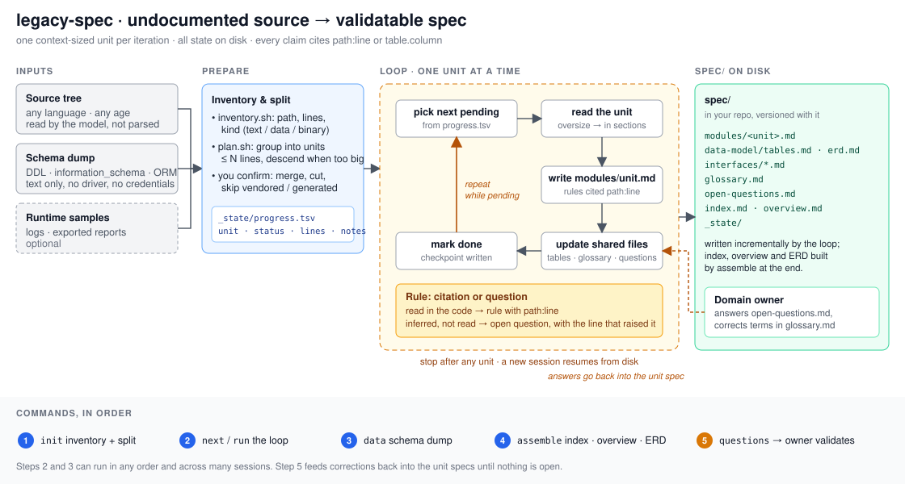

# legacy-spec

Turns an undocumented legacy system into a specification you can validate, one unit at a time.

Before a rewrite, a migration or a handover, someone has to answer "what does this thing actually do?". The answer lives in the code, in the database and in the head of whoever is left. The code is too big for one context window and too old for the original authors, so most attempts end as a partial summary that stops being trusted the first time it is wrong.

legacy-spec is built around that constraint. It keeps all state on disk, specs one context-sized unit per iteration, cites every claim to a file and line, and resumes from where it stopped in any session.

## How it works



1. **Inventory.** `scripts/inventory.sh` lists every file with lines, size, date and kind (text, data, binary). Nothing is read yet.
2. **Split.** `scripts/plan.sh` groups files into units of at most N lines (default 4000), descending into any directory that is too large. You confirm the split, skip generated code and vendored libraries, merge or cut units. The result is `spec/_state/progress.tsv`.
3. **Loop.** `/legacy-spec next` or `run` takes the next pending unit, reads it, writes `spec/modules/<unit>.md` from the template (purpose, entry points, inputs and outputs, rules with `path:line`, state transitions, dependencies, suspected dead code, open questions), updates `data-model/tables.md`, `glossary.md` and `open-questions.md`, marks the unit done and moves on. Each unit is one checkpoint. Stop any time; a fresh session resumes.
4. **Data.** `/legacy-spec data <schema-dump>` specs the database from a text export (DDL, information_schema, ORM models, stored procedures). No database driver, no connection.
5. **Assemble.** `/legacy-spec assemble` writes `index.md` as a tree map of all units, rewrites `overview.md` from the module specs, de-duplicates the glossary, groups open questions by unit and builds a mermaid ERD.

A SessionStart hook tells you when a spec is in progress in the current project and how many units remain.

## Commands

```
/legacy-spec init ./src --max-lines 4000   inventory, propose units, create spec/ skeleton
/legacy-spec next [N]                      spec the next N pending units
/legacy-spec run                           loop until nothing is pending (or context runs low)
/legacy-spec data schema.sql               spec tables, keys, triggers from a text dump
/legacy-spec status                        progress table
/legacy-spec assemble                      index, overview, glossary, questions, ERD
/legacy-spec questions                     everything inferred, for the domain owner to answer
```

## What you get

```
spec/
  overview.md          purpose, actors, main flows, runtime shape
  index.md             tree map: every unit, one line, linked
  glossary.md          domain terms as the code names them, with evidence
  open-questions.md    what the code does not prove, grouped by unit
  data-model/          tables.md (columns, keys, readers and writers), erd.md
  modules/<unit>.md    one cited spec per unit
  interfaces/          screens, jobs, files, APIs, queues, reports crossing the boundary
  _state/              inventory.tsv, progress.tsv, plan.md
```

## Design choices

- **Disk is the memory.** Every iteration starts by reading `progress.tsv` and ends by writing it. No unit is held in flight across a session boundary. Large systems are a matter of more iterations, not a bigger model.
- **Citation or question.** A rule without a `path:line` is not written. An inference goes to open questions with the line that raised it. The spec is checkable by someone who did not write it.
- **Code language first.** Identifiers are kept as the code has them, with the business term alongside once it is evident. The domain owner validates terms, not translations.
- **No modernisation.** The spec says what the system does. What it should do, and on what stack, is a different task.
- **Any language, any database.** The model reads the source; the scripts only count and group. Database input is a text dump, so no drivers and no credentials.

## Install

```
/plugin install legacy-spec --marketplace andremoah/claude-plugins
/legacy-spec init ./path/to/legacy/source
```

## What is inside

- `scripts/inventory.sh` — file inventory; `scripts/plan.sh` — unit split; `scripts/status.sh` — progress
- `hooks/hooks.json` — SessionStart reminder when units are pending
- `commands/legacy-spec.md` — init · next · run · data · status · assemble · questions
- `skills/legacy-spec/SKILL.md` — the procedures and rules
- `skills/legacy-spec/templates/` — module and plan templates
