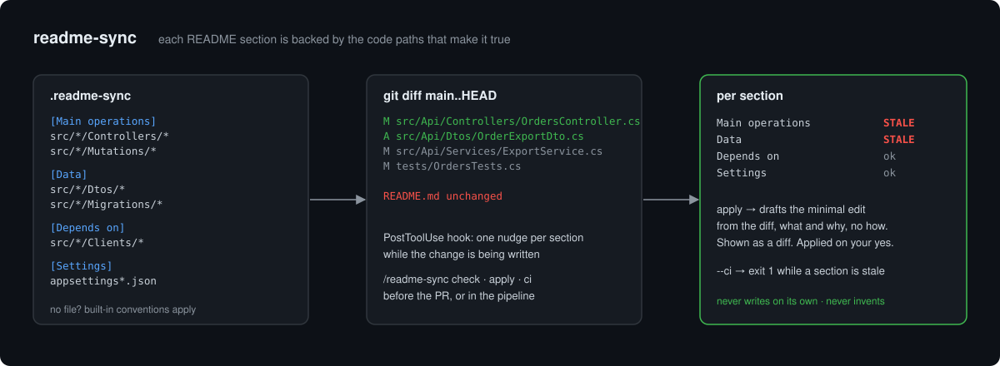

# readme-sync

Keeps a repository's functional README true to its code.

Your README is read by support, product, on-call and whatever developer portal indexes it. It says what the component does, what it stores, what it calls and how it is configured. Every one of those sentences is backed by some code path, and when that path changes the sentence goes stale, quietly. Agentic coding makes this faster: more changes, same habit of not touching the docs.

readme-sync makes the link explicit and checks it.

## How it works



1. **A mapping.** `.readme-sync` at the repo root lists README sections and the path globs that make them true. No file? Built-in conventions cover controllers, resolvers, queries and mutations (operations), DTOs, migrations and models (data), clients and integrations (depends on), settings and manifests (settings).
2. **A check.** `scripts/stale.sh` diffs a range (default: merge-base with main to your working tree) and reports each section as `ok`, `updated`, `STALE` (its code changed, it did not) or `NO-HEAD` (the section is missing).
3. **A nudge while writing.** A PostToolUse hook fires once per section per session when Claude edits a mapped file: "this maps to *Data*; update it in the same change if a reader would notice". It never edits.
4. **A fix on request.** `/readme-sync apply` reads the diff of the signal files and drafts the minimal edit for the stale section, what and why, no implementation detail. Shown as a diff, applied after you say yes, one section at a time.
5. **A gate if you want one.** `--ci` exits 1 while a mapped section is stale.

## Commands

```
/readme-sync                 check: per-section table for main..working tree
/readme-sync check --base origin/release
/readme-sync apply           draft + approve edits for stale sections
/readme-sync init            propose a .readme-sync from this repo's headings and folders
/readme-sync ci              print the pipeline line for this repo
```

## CI

```yaml
- name: README in step with code
  run: bash readme-sync/scripts/stale.sh --root . --base origin/main --head HEAD --ci
```

Vendor `scripts/stale.sh` and `.readme-sync` into the repo, or check out this plugin in the job. Pair it with a review rule: a STALE row needs either the README change or one line in the PR saying nothing reader-visible changed.

## Design choices

- **Sections, not the whole file.** "README changed" is too weak a signal; a changelog line hides a stale Data section. Matching happens at heading level.
- **Package manifests are not dependencies.** A version bump is not a new external system. The default *Depends on* mapping covers client and integration code, not `package.json`.
- **A person approves every edit.** The draft comes from the diff, is shown as a diff and goes in on an explicit yes. The plugin never invents behaviour and flags with a TODO what the diff cannot tell it.
- **Bash and git only.** Runs in any CI image with no install step.

## Install

```
/plugin install readme-sync --marketplace andremoah/claude-plugins
/readme-sync init
```

## What is inside

- `hooks/hooks.json` — PostToolUse nudge
- `scripts/stale.sh` — the check; `scripts/nudge.sh` — the hook body
- `commands/readme-sync.md` — check · apply · init · ci
- `skills/readme-sync/SKILL.md` — how edits are drafted and what is never done
- `examples/.readme-sync` — sample mapping
